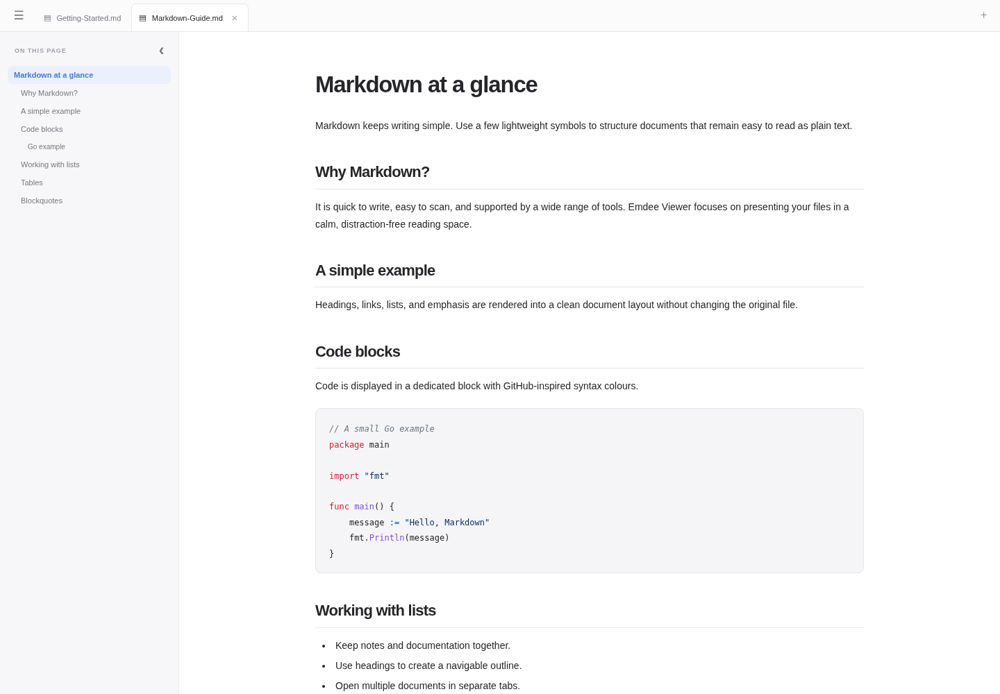
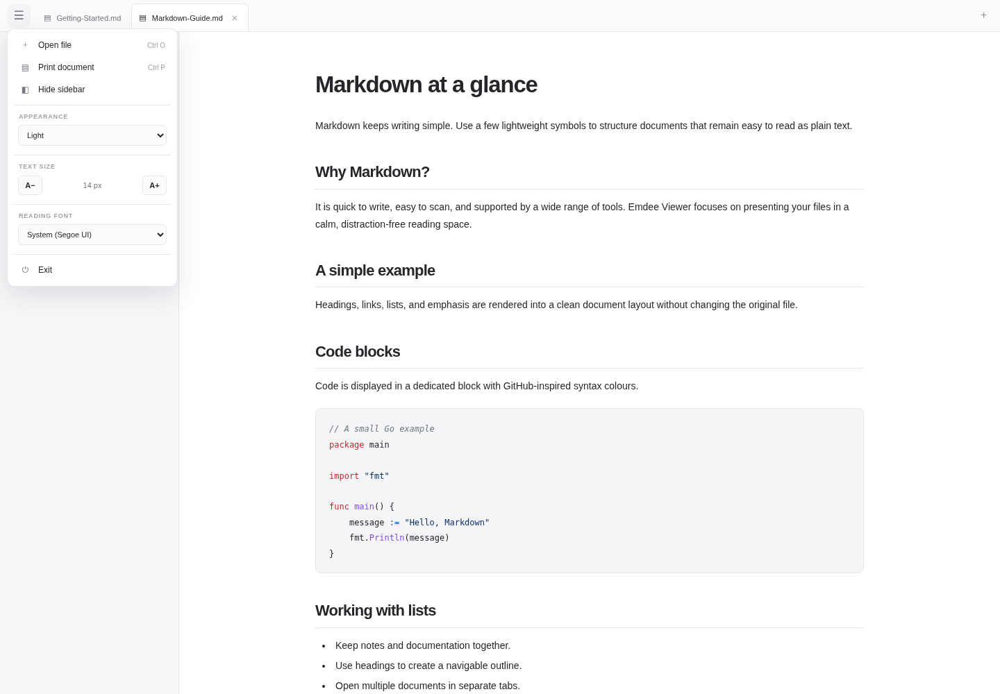

  

<h1 align="center">Emdee Viewer</h1>

  A lightweight Windows application for reading Markdown files.

  

## Interface

The document view keeps the reading area uncluttered, with tabs for open files and a collapsible outline for navigating longer documents.

  

The application menu provides access to file opening, printing, sidebar visibility, appearance, reading size, font selection, and exit.

## Features

- Tabbed Markdown document viewing
- GitHub Flavored Markdown and GitHub-style syntax highlighting
- Light and dark appearance
- Adjustable reading size and selectable reading fonts
- Document outline with a collapsible sidebar
- Five most recently opened files shown on the home screen
- Open multiple files and drag files into the window
- Print-friendly document layout and Windows print dialog
- Keyboard shortcuts: `Ctrl+O` open, `Ctrl+P` print, `Ctrl+W` close tab, and `Ctrl+Tab` switch tabs
- Local-first operation; document contents are not uploaded

## Requirements

- Windows 10 or later
- Go 1.23 or later to build from source
- Microsoft Edge WebView2 Runtime

## Build from source

1. Install Go from <https://go.dev/dl/>.
2. Confirm the Microsoft Edge WebView2 Runtime is installed.
3. Run `build.bat` from the project directory.
4. The build creates `EmdeeViewer.exe` in the project directory.

The first build downloads the Go module dependencies. Subsequent builds can use the local module cache.

## Application icon

The repository does not include a Windows `.ico` file. Add your icon at `assets/app.ico` when preparing a release. The build script detects that file and embeds it into the Windows executable; if it is absent, the build uses the default executable icon.

## Recent files

The home screen displays up to five recent filenames and dates. Windows file-picker security does not allow the application to silently reopen a previously selected file, so choosing a recent entry prompts you to select the file again. Recent history stores filenames and dates, not document contents.

## Printing

Choose **Print document** from the application menu or press `Ctrl+P`. The print stylesheet hides application controls and applies page margins and print-specific layout rules. Final pagination is handled by the Windows print system and the selected printer or PDF driver.

## Limitations

Emdee Viewer is a reader, not an editor. Relative paths for local images in Markdown documents are not currently resolved.

## License

This project is licensed under the MIT License. See [LICENSE](LICENSE).
